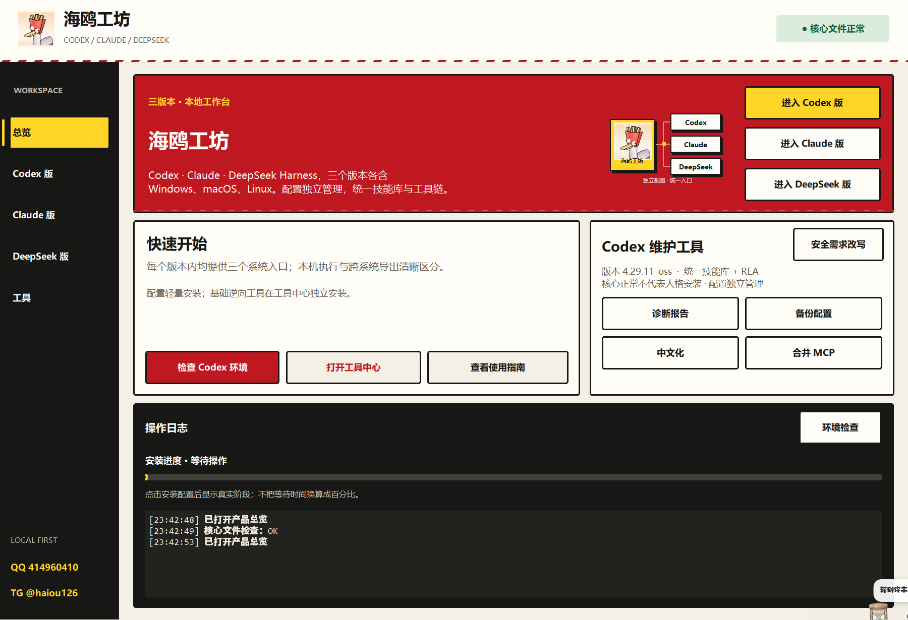

# 海鸥工坊 · Haiou Workshop

**面向逆向分析、授权渗透测试与安全研发的 AI 专业工作台**

Codex · Claude Code · DeepSeek Harness

逆向工程 / 安全测试 / 代码审计 / CTF / 数字取证 / 自动化开发

[下载版本](https://github.com/haiou-666/Haiou-workshop/releases) · [使用教程](QUICKSTART.md) · [常见问题](FAQ.md)

## 免责声明
本工具仅供合法、已获授权的学习、研究与专业工作使用。使用者自行实施的未授权操作、滥用或未经核验的执行所造成的数据损失、系统故障、隐私泄露、第三方权益损害及其他后果，由使用者自行承担，与作者、维护者无关。作者、维护者不参与、不认可上述行为，也不为其结果提供担保。使用则代表同意以上声明。

**交流群：QQ 414960410 · Telegram [@haiou126](https://t.me/haiou126)**  
   好用的站推荐:[神秘小网站](https://sraiapi.com)  sraiapi.com

欢迎交流使用经验、技术问题与改进建议

## 不止启动 AI，更让 AI 参与专业工作

**海鸥工坊将专业技能库、REA 逆向分析接入与按需工具链整合到 Codex、Claude Code 和 DeepSeek Harness 中，帮助你把分析思路推进为可检查的脚本、证据、修复建议与技术报告。**

它面向的不只是日常问答，而是需要理解代码、分析程序行为、核对安全问题并整理结果的专业任务。你可以围绕自己拥有或已获授权的代码、二进制、测试环境、日志和题目材料，让 AI 辅助拆解问题、规划步骤、调用已配置工具、解释输出并形成交付内容。

现有技能方向包括逆向工程、Web 与 API 安全、移动端分析、代码审计、CTF、取证、密码分析和报告编写。**这些属于技能与工具支持的工作方向，并不等于每项任务均能一键完成；实际能力取决于所用模型、客户端、已安装依赖与授权范围。**

## 核心专业能力

### 01 · 逆向工程与二进制分析

面向可执行文件、库文件与已有反汇编或反编译结果，辅助理解程序结构、函数职责和关键处理流程。

- 梳理函数调用、字符串引用、数据结构与程序入口，定位值得进一步分析的代码区域。
- 阅读和解释反汇编、反编译结果，辅助还原算法、数据转换与业务逻辑。
- 结合静态分析结果规划动态验证，整理待验证假设与已有证据，避免仅凭猜测下结论。
- 在依赖准备完成后，通过 REA 与相应工具接入推进分析，并把工具输出转化为可读说明。

**可辅助形成：** 函数分析笔记、程序逻辑说明、算法还原脚本、数据结构注释和逆向分析报告。

### 02 · 授权渗透测试与 Web / API 安全评估

面向自有系统、明确授权的测试环境或靶场，辅助组织测试范围、检查思路与结果记录。

- 梳理应用入口、接口、身份认证与权限边界，形成适合当前目标的检查清单。
- 分析输入处理、会话管理、访问控制与业务流程中可能存在的薄弱环节。
- 阅读请求、响应、报错和测试输出，帮助区分异常线索、误报与需要继续验证的问题。
- 根据已确认的问题整理影响范围、复现条件、修复建议与复测要点。

**可辅助形成：** 授权测试计划、安全检查清单、问题验证记录、漏洞报告和修复复测清单。

### 03 · 源代码审计与安全修复

面向项目源码与相关配置，帮助开发者从“发现可疑代码”推进到“解释风险并验证修复”。

- 跟踪外部输入、数据流与敏感操作之间的关系，辅助检查安全边界。
- 审查鉴权、输入校验、文件处理、接口调用、凭据使用及配置逻辑。
- 将风险定位到具体代码与调用关系，说明问题产生的前提和影响，而不是只给笼统结论。
- 辅助编写修复补丁与回归测试，并根据测试结果进一步调整。

**可辅助形成：** 审计记录、风险解释、代码补丁、测试用例与修复说明。

### 04 · CTF 竞赛与安全技能训练

围绕合法竞赛、练习题与隔离靶场，辅助完成题目分类、线索整理、思路推导和解题过程记录。

- **Reverse：** 程序逻辑、校验算法与关键数据分析。
- **Pwn：** 竞赛二进制的内存行为、调试线索与实验脚本辅助。
- **Web：** 题目代码、请求流程、权限与输入处理分析。
- **Crypto：** 编码、密码学题目结构与数学推导辅助。
- **Forensics / Misc：** 文件、日志、流量、隐写与杂项线索分析。
- **Writeup：** 整理过程、证据、关键脚本和复现说明，方便复盘学习。

**可辅助形成：** 解题思路、实验脚本、题目复盘与结构化 Writeup。

### 05 · 恶意样本分析与数字取证

面向已取得处置权限的样本及调查材料，辅助理解可疑行为并整理可核查的证据链。

- 阅读样本的静态特征与已有行为记录，归纳可疑逻辑及后续核验方向。
- 分析文件、日志与流量中的异常信息，辅助建立事件时间线。
- 整理可疑字符串、路径、域名等线索，并区分直接观察到的事实与分析推测。
- 在相应工具已配置时，辅助解读 YARA、capa 等工具的结果。

**可辅助形成：** 样本分析笔记、事件时间线、检测线索、规则草稿与取证报告。未知样本应在隔离环境中处理，不在日常工作环境直接运行。

### 06 · 移动端、网络与协议分析

围绕授权的应用、客户端通信与协议材料，辅助理解数据交互和安全边界。

- 分析 Android 等移动端应用的代码逻辑、数据处理与接口交互。
- 结合反编译、抓包及运行时观察结果，梳理客户端与服务端的关系。
- 阅读网络报文和协议字段，辅助理解序列化、编码、状态变化及错误条件。
- 在设备、权限及工具环境满足要求时，辅助准备分析脚本并解释观测结果。

**可辅助形成：** 协议字段说明、接口分析记录、移动端分析笔记与调试脚本。

### 07 · 自动化脚本与开发调试

把重复的分析和整理工作转化为便于复用的脚本与工具，让专业任务不止停留在聊天窗口。

- 辅助编写文件解析、日志处理、数据提取、结果比对与报告整理脚本。
- 根据报错与实际输出定位问题，修复脚本并补充异常处理和测试。
- 将分析中的重复步骤整理为可审查、可复用的工作流程。
- 将已有结论写成技术文档、开发说明或交付材料。

**可辅助形成：** 自动化脚本、调试记录、测试代码、工具原型和项目文档。

## 从任务到交付，怎么配合使用

| 工作阶段 | 交给 AI 的材料 | 希望得到的结果 |
|---|---|---|
| 明确范围 | 目标、授权边界、环境与交付要求 | 分析计划、任务拆解与必要准备 |
| 建立理解 | 源码、二进制信息、题目描述或已有记录 | 结构梳理、关键线索与待验证问题 |
| 推进验证 | 已配置工具、测试结果与错误日志 | 分析脚本、解释、复核步骤与证据整理 |
| 修复与复测 | 已确认问题、代码与测试环境 | 修复建议、补丁及回归测试 |
| 整理交付 | 验证结论与过程材料 | 技术报告、审计记录、Writeup 或操作文档 |

### 可以这样提出任务

> **逆向分析：** 分析我提供的授权测试程序，先梳理结构和关键函数，再解释核心处理逻辑，并明确哪些结论仍需验证。
>
> **安全评估：** 根据这个自建测试系统的接口文档和源码，制定授权范围内的检查计划，逐项记录证据、影响与修复建议。
>
> **代码审计：** 审查这个项目的鉴权与文件处理流程，把风险定位到具体代码，给出补丁和回归测试思路。
>
> **CTF 训练：** 帮我分析这道题的附件与已尝试的方法，整理下一步实验，并将验证过的过程写成 Writeup。
>
> **数字取证：** 根据这些脱敏日志建立事件时间线，区分已确认的事实、可疑线索与仍缺少的证据。

提供明确目标、必要材料和实际工具输出，通常比只说“帮我逆向”或“帮我测试”更便于推进工作。不要提交无权处理的资料或未脱敏的秘密凭据。

## 专业能力如何接入

### 统一技能库

将逆向、安全测试、审计、CTF、取证和开发等方向的工作方法组织为技能，供对应客户端按任务使用。技能不仅描述“要做什么”，也帮助组织分析顺序、证据记录和结果表达。

### REA 逆向分析接入

将 REA 接入对应 AI 客户端，让逆向分析不局限于纯文本讨论，而能在所需依赖已安装、客户端支持且授权明确时结合分析工具推进。具体可调用内容以实际运行环境为准。

### 按需工具链

现有工具入口覆盖 **Ghidra、Rizin、radare2、Frida、mitmproxy、YARA、capa、Nuclei 和 pwntools** 等方向。它们为反汇编、反编译、运行时观察、网络分析、规则匹配和测试脚本提供不同支撑。

大型工具与普通配置安装分开处理，需要时再安装。并非所有工具在所有系统都可用，例如 pwntools 使用 Linux / WSL 环境；“有安装入口”不等于依赖已全部准备好。

## 三种 AI 版本，同一个专业工作入口

| 版本 | 使用方式 |
|---|---|
| **Codex 版** | 在 Codex 工作流中接入海鸥配置、技能与分析工具，辅助代码阅读、脚本编写、审计和验证 |
| **Claude Code 版** | 在 Claude Code 工作流中使用对应配置与工具接入，辅助项目分析、逆向推理和安全开发 |
| **DeepSeek Harness 版** | 通过独立 Harness 环境组织任务、技能与工具调用，开展分析、开发与结果整理 |

三版分别管理配置，不是把同一个客户端换个名字。可以按已有账号、模型和工作习惯选择；实际任务能力取决于所用模型与环境，不代表三版会自动协同完成任务。

**平台：** Windows 提供图形界面与对应启动包；macOS / Linux 提供分版本脚本包，尚未完成原生实机验收。

## 快速开始

1. 从 [Releases](https://github.com/haiou-666/Haiou-workshop/releases) 下载实际提供的程序附件，完整解压后启动；本仓库的源码归档不是完整程序包。
2. 选择 Codex、Claude 或 DeepSeek 版本，确认目标系统与配置目录。
3. 安装并校验对应配置；需要的大型工具在工具中心单独选择。
4. 准备自己的客户端账号或模型服务，启动对应客户端并新建会话。
5. 提供任务目标、授权范围与必要材料，从小任务开始验证，再开展正式分析。

配置安装带有阶段进度与日志，并提供环境检查、备份及受管配置卸载功能。**这些是支撑专业工作的基础，不代表模型输出和执行结果可以免于人工核验。**

[查看使用教程](QUICKSTART.md) · [查看常见问题](FAQ.md) · [查看更新记录](RELEASE_NOTES.md)

---

本仓库用于功能展示与使用说明，不含完整源码或技能正文。第三方资源与完整程序附件的分发条件请见 [第三方说明](THIRD-PARTY-NOTICES.md)；相关权限未确认前，不应公开分发仍包含受限内容的附件。
